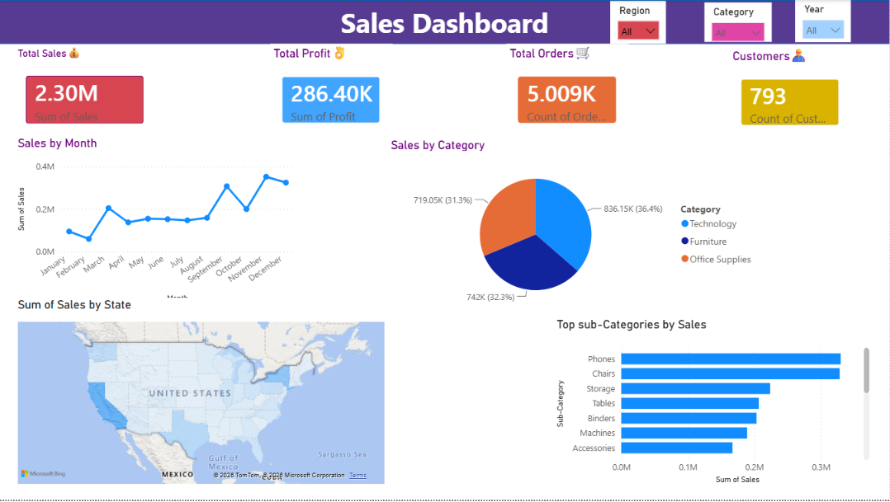

# Sales Data Analysis

Sales analysis of the Superstore dataset using Python, MySQL and Power BI.

## Tools Used
- Python (Pandas, NumPy, Matplotlib)
- MySQL
- Power BI

## Dataset
Superstore sales data from Kaggle (9,994 rows, 21 columns).

## What I Did
1. Cleaned the data and fixed date columns in Python
2. Found key numbers with Pandas (sales, profit, orders, customers)
3. Loaded the data into MySQL and wrote SQL queries
4. Built an interactive dashboard in Power BI

## Key Numbers
- Total Sales: 2.30M
- Total Profit: 286.40K
- Profit Margin: 12.47%
- Total Orders: 5,009
- Customers: 793

## Insights
- Furniture has only about 2.5% profit margin, while Technology and Office Supplies have about 17%
- Tables and Bookcases are sold at a loss
- Central region has the lowest margin (about 8%), West has the highest (about 15%)
- Yearly sales grew from 484K (2014) to 733K (2017), with a small dip in 2015

## Dashboard

## Project Structure
- `data/` - dataset
- `notebooks/` - Python analysis
- `sql/` - MySQL queries
- `dashboard/` - Power BI file
- `screenshots/` - charts and dashboard image

## How to Run
1. Open `notebooks/sales_analysis.ipynb` and run the cells
2. For MySQL, put your own password in the connection cell
3. Open `dashboard/Sales_Dashboard.pbix` in Power BI Desktop